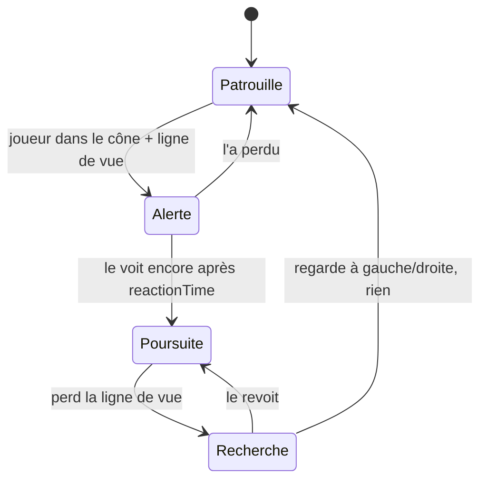

# Araignée (Spider)

![[Mob_Araignee.jpg|220]]

## Rôle dans le jeu
Mob qui **tisse des toiles dans les couloirs**. Lorsqu'un joueur entre dans une toile, il est **très fortement ralenti** et l'araignée qui l'a tissée est **alertée** et vient l'attaquer. En temps normal, l'araignée rôde et réagit aux joueurs qui entrent dans sa zone de vision.

## Comportement — design
- Pose de toiles (ralentissement) + attaque à vue.
- Décor associé : toiles d'araignées — [[Direction_Artistique]].

## Comportement — état actuel du code

- **Patrouille :** points aléatoires sur le NavMesh (dans `patrolRange`), pause de `waitTimeAtPoint`.
- **Alerte :** s'arrête et fixe le joueur pendant `reactionTime`.
- **Recherche :** regarde à -45° puis +45° avant de reprendre sa patrouille.
- **Écarts avec le design :** pas de toiles, **aucun dégât** (pas de `DamageDealer` sur le prefab).

## Stats et tuning
| Paramètre | Défaut | Rôle |
|---|---|---|
| `viewRadius` | 15 | Portée de vision |
| `viewAngle` | 90 | Angle du cône de vision |
| `patrolSpeed` | 3.5 | Vitesse de patrouille |
| `chaseSpeed` | 6 | Vitesse de poursuite |
| `waitTimeAtPoint` | 2 | Pause entre deux points |
| `patrolRange` | 30 | Rayon de patrouille |
| `reactionTime` | 1 | Délai avant poursuite / recherche |
| `searchTurnSpeed` | 2 | Vitesse de rotation en recherche |
| ralentissement de la toile | ? | à créer |

## Implémentation technique
- **Prefab :** `Assets/Prefabs/Characters/Spider.prefab` · **Script :** `EnemySight.cs` (sert de base à l'IA générique)
- **Spawn :** [[Apparition_Ennemis]]
- **À faire :** toiles (trigger + ralentissement + alerte de la tisseuse), attaque, variante de nuit.

## Questions ouvertes
- [ ] Combien de toiles par araignée ? Les toiles sont-elles destructibles (allumettes / torche) ?
