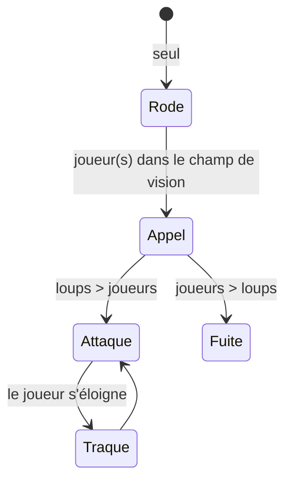

# Loup

## Rôle dans le jeu
Un animal **peureux** qui chasse en **meute**. Il punit les joueurs isolés et récompense ceux qui restent groupés — [[Multijoueur]].

## Comportement (design)

- Il **rôde seul**.
- Quand un ou plusieurs joueurs entrent dans son champ de vision, il **appelle le nombre de loups nécessaire pour être en supériorité numérique**.
- Logique de meute : **si joueurs > loups → fuite**, **si loups > joueurs → attaque**.
- Les loups peuvent **traquer les joueurs sur une plus longue distance** que les autres mobs.
- Son : hurlement.

## Stats et tuning
| Paramètre | Valeur | Rôle |
|---|---|---|
| Portée de traque | > autres mobs | |
| Rayon d'appel de la meute | ? | |
| Vitesse | ? | |
| Dégâts | ? | |

## Implémentation technique
- Base possible : `EnemySight.cs` + gestionnaire de meute (compte des loups / joueurs proches).
- **Spawn :** [[Apparition_Ennemis]]

## Questions ouvertes
- [ ] D'où viennent les renforts (loups déjà présents ou apparition) ?
- [ ] En solo, un seul joueur → les loups attaquent toujours ?
