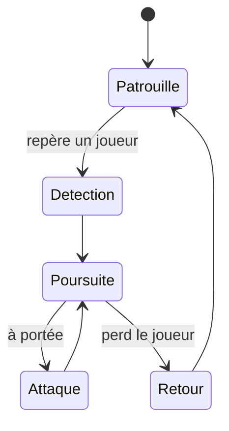

# Souris

![[Mob_Souris_Jour.jpg|180]] ![[Mob_Souris_Nuit.jpg|180]]
*De jour / de nuit (illustration du brainstorming de la variante de nuit).*

## Rôle dans le jeu
**Mob de base**, présent **dans toutes les zones** du labyrinthe (décidé le 2026-11-08) — [[Bestiaire]]. C'est l'ennemi le plus courant : il apprend au joueur à se battre et entretient une pression constante entre deux rencontres plus dangereuses.

Lien avec le gardien **Rat**, chef du groupe des souris : dans son arène, il appelle des **vagues de souris** — [[Gardiens]].

## Comportement (machine à états)
IA de base commune du [[Bestiaire]] (hypothèse, à valider : pas encore de règle propre à la Souris).

- **La nuit :** plus rapide, plus forte, aggro plus large, yeux rouges — [[Cycle_Jour_Nuit]].

## Stats et tuning
| Paramètre | Valeur | Rôle |
|---|---|---|
| PV | ? | Doit mourir en peu de coups |
| Vitesse (jour / nuit) | ? | |
| Dégâts | ? | ½ cœur ? |
| Sens / portée de détection | ? | [[Discretion_et_Aggro]] |
| Or lâché | ? | [[Economie]] |
| Proportion parmi les mobs | ? | Le plus courant |

## Comment le joueur le contre
- Combat direct (arme, poussée) — [[Combat_Attaque]].

## Feedback (anim / son / VFX)
- Couinements, variante de nuit (yeux rouges, textures sombres).

## Implémentation technique
- **Prefab :** à créer
- **Scripts :** IA de base à mutualiser avec les autres mobs (`EnemySight` existe déjà pour la vision en cône).
- **Spawn :** toutes les zones — voir [[Apparition_Ennemis]]

## Questions ouvertes
- [x] La Souris est-elle un mob à part entière ? → **oui**, mob de base dans toutes les zones (2026-11-08)
- [ ] A-t-elle une règle propre (pilier « Chaque mob a sa règle ») : en groupe, fuit seule, vole des objets… ou reste-t-elle volontairement simple ?
- [ ] Seule ou en groupe ?
- [ ] Les souris du Rat (en arène) sont-elles les mêmes que celles du labyrinthe ?
