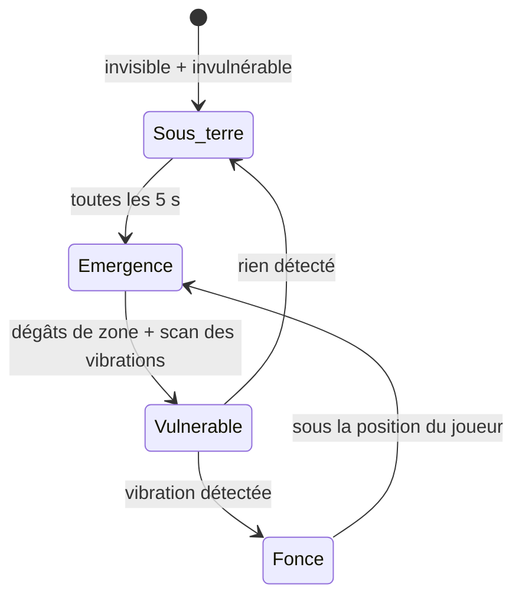

# Taupe

## Rôle dans le jeu
Menace d'**embuscade** qui détecte les **vibrations** : force les joueurs à surveiller leurs déplacements — [[Discretion_et_Aggro]].

## Comportement (design)

- Se déplace **sous terre** : **invisible et invulnérable**.
- **Fait surface toutes les 5 secondes** ; à l'émergence, inflige des **dégâts de zone** et **scanne** les environs.
- Si elle détecte une **vibration**, elle **fonce sous terre** vers la position du joueur.
- Une fois sortie, elle reste **immobile quelques instants** → **fenêtre d'attaque** pour les joueurs.
- Animation spécifique : enfouissement.

## Stats et tuning
| Paramètre | Valeur | Rôle |
|---|---|---|
| Intervalle d'émergence | 5 s | |
| Rayon des dégâts de zone | ? | |
| Rayon de détection des vibrations | ? | |
| Durée d'immobilité | « quelques instants » | Fenêtre d'attaque |

## Questions ouvertes
- [ ] Qu'est-ce qui produit une vibration : marcher, courir, sauter ? L'accroupissement l'évite-t-il ?
- [ ] Indice visuel de son déplacement (terre qui bouge) ?
