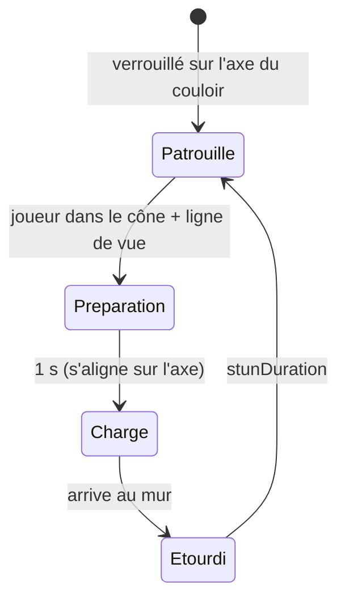

# Taureau (Bull)

![[Mob_Taureau.jpg|220]]

## Rôle dans le jeu
Mob qui **prend toute la largeur des couloirs** : dès qu'il aperçoit le joueur, il prend quelques secondes puis **charge** dans sa direction. Pousse le joueur à éviter les longs couloirs à découvert.

## Comportement — design (brainstorming)
- Il ne s'arrête que dans **3 cas** :
  1. il rentre dans un **mur** ;
  2. il rentre dans un **joueur** ;
  3. il se fait **parer par un bouclier** porté par un joueur.
- Une fois arrêté, il est **étourdi quelques secondes** puis reprend sa patrouille.
- **Joueur percuté (décidé le 2026-11-08) :** **1 cœur** de dégâts et un **gros recul**.
- **Signal de charge (décidé le 2026-11-08) :** avant de charger, il **gratte le sol en soufflant** (animation + son), ce qui laisse le temps de **rouler** hors de l'axe — [[Deplacement_Joueur]].
- Animation spécifique : charge.

> [!success] Décidé le 2026-11-08 : le Taureau est un **mob classique**
> Il n'est ni gardien (le « Taureau chef du troupeau de veaux » du tableau Boss est abandonné) ni Forgeron (devenu un Cheval). L'illustration du taureau endormi sur le fragment reste un simple exemple du vol de nuit — [[Gardiens]].

## Comportement — état actuel du code

- **Patrouille « sur rail »** : se verrouille sur l'axe du couloir et fait des allers-retours. `randomTurnChance` = probabilité de demi-tour chaque seconde.
- **Vision :** BoxCast droit devant + ligne de vue.
- **Charge :** ligne droite jusqu'au mur, sans tourner.
- **Étourdi :** recule de 4 m, immobile `stunDuration` s.
- **Dégâts pendant la charge (cumulatifs) :** zone « vapeur » (`zoneRadius`) + contact (`contactThreshold`).
- **Écarts avec le design :** la charge ne s'arrête **ni sur un joueur ni sur un bouclier** (traverse le joueur) ; pas de variante de nuit.

## Stats et tuning
| Paramètre | Défaut | Rôle |
|---|---|---|
| `visionWidthRatio` | 30 | Largeur de vision (× largeur du corps) |
| `visionHeight` | 5 | Hauteur de la boîte de vision |
| `maxVisionDistance` | 300 | Portée de vision / de charge |
| `patrolSpeed` | 8 | Vitesse de patrouille |
| `chargeSpeed` | 100 | Vitesse de charge |
| `stunDuration` | 5 | Durée d'étourdissement |
| `randomTurnChance` | 0 | % de demi-tour aléatoire / s |
| `zoneRadius` | 15 | Rayon des dégâts de zone |
| `contactThreshold` | 5 | Rayon des dégâts de contact |
| `zoneDamage` / `contactDamage` | 1 / 1 | Demi-cœurs retirés |
| `zoneCooldown` / `contactCooldown` | 1 / 1.5 | Délais entre deux dégâts |
| préparation de charge | 1 s (codé en dur) | « quelques secondes » dans le design |

## Comment le joueur le contre
- Sortir de l'axe du couloir.
- **Parer avec un bouclier** → étourdissement — [[Combat_Attaque]].
- Frapper pendant l'étourdissement.

## Implémentation technique
- **Prefab :** `Assets/Prefabs/Characters/Bull.prefab` · **Script :** `BullAI.cs`
- **Spawn :** couloirs larges uniquement — [[Apparition_Ennemis]]
- **À faire :** arrêt sur collision joueur / bouclier, variante de nuit, PV et loot.

## Questions ouvertes
- [x] Le joueur percuté prend-il des dégâts et un knockback ? → **1 cœur + gros recul** (2026-11-08). Le code actuel retire 1 demi-cœur par source (`zoneDamage` / `contactDamage`) : à aligner.
- [x] Feedback de préparation de charge ? → **gratte le sol en soufflant** (anim + son) (2026-11-08)
- [ ] Durée de la préparation (1 s codée en dur aujourd'hui) : suffisante pour réagir avec une roulade ?
