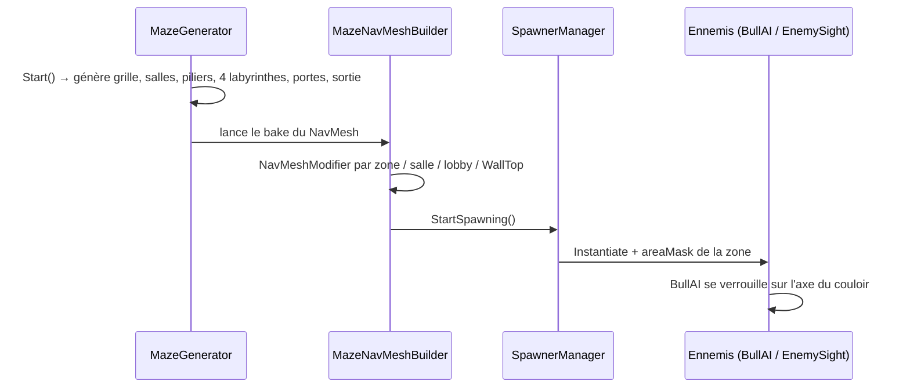

# Vue d'ensemble du code

Tous les scripts sont dans `Assets/Scripts/` (pas encore de sous-dossiers par système, ni d'Assembly Definitions, ni de namespaces).

## Carte des scripts
| Système | Scripts | Note GDD |
|---|---|---|
| Joueur — mouvement / caméra | `PlayerController`, `AnimationStateController` | [[Deplacement_Joueur]] |
| Joueur — attaque | `PlayerController.Attack()` | [[Combat_Attaque]] |
| Joueur — santé | `PlayerHealth`, `RagdollController`, `HeartUIManager`, `DamageDealer` | [[Sante_et_Degats]] |
| Inventaire | `InventorySystem`, `InventoryUI`, `Items/ItemData`, `Items/WeaponItem`, `Items/ConsumableItem`, `Items/ItemWorld` | [[Inventaire]] |
| Ramassage | `GrabObject` | [[Ramassage_Objets]] |
| Labyrinthe | `MazeGenerator`, `MazeCell`, `MazeNavMeshBuilder`, `TerrainGenerator` | [[Generation_Labyrinthe]] |
| Ennemis | `BullAI`, `EnemySight`, `SpawnerManager` | [[Taureau]], [[Araignee]], [[Apparition_Ennemis]] |
| Ambiance | `DayNightCycle` | [[Cycle_Jour_Nuit]] |
| Global | `GameManager` (singleton, matériau d'outline) | — |
| Divers | `InitialisationPositionObjet` | — |

### Systèmes du GDD sans code pour l'instant
[[Cycle_de_Partie]] (timer 10 jours, victoire / défaite) · [[Fragments_et_Cle]] · [[Economie]] · [[Enlevement_des_PNJ]] · [[Discretion_et_Aggro]] · [[Carte_et_Navigation]] · [[Multijoueur]] · mobs [[Loup]], [[Taupe]], [[Aigle]] · [[Gardiens]] · [[PNJ]].

## Flux d'initialisation de la scène Labyrinthe

## Communication entre systèmes
- **Événements C#** : `PlayerHealth.OnSanteChangee(int)` → `HeartUIManager` ; `InventorySystem.OnInventoryChanged` / `OnSelectionChanged(int)` → `InventoryUI`, `GrabObject`.
- **Appels directs** : `BullAI` / `DamageDealer` → `PlayerHealth.Blesser()` → `PlayerController.ApplyKnockback()` / `RagdollController.EnableRagdoll()`.
- **Input System** : composant `PlayerInput` en mode *Invoke Unity Events*, qui appelle `Move`, `Jump`, `Sprint`, `Attack`, `OnGrabInput`, `OnScrollInventory`.
- **Données** : ScriptableObjects `ItemData` dans `Assets/Data item/`.

## Packages notables
URP 17.2 · Input System 1.14 · Cinemachine 2.10 (API `CinemachineVirtualCamera` / `FreeLook`, pas la v3) · AI Navigation 2.0 · Netcode for GameObjects 1.14 (installé, non utilisé) · VFX Graph 17.2 · Timeline · Visual Scripting.

## Décisions techniques
Les choix structurants sont consignés dans `Decisions/` (format ADR, template `Template_Decision_ADR`).
