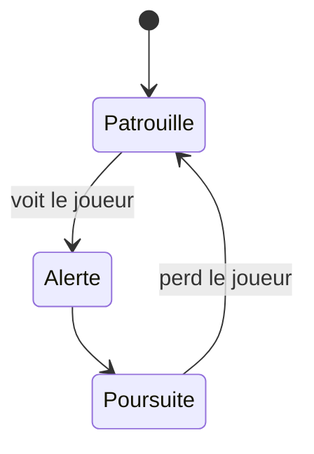

# {{title}}

## Rôle dans le jeu
Quelle pression il met sur le joueur, où on le rencontre, ce qui le rend unique.

## Comportement (machine à états)

## Stats et tuning
| Paramètre | Valeur | Rôle |
|---|---|---|
| Vitesse | | |
| Dégâts | | |
| Vision | | |

## Comment le joueur le contre
-

## Feedback (anim / son / VFX)
-

## Implémentation technique
- **Prefab :**
- **Scripts :**
- **Spawn :** voir [[Apparition_Ennemis]]

## Questions ouvertes
- [ ]
