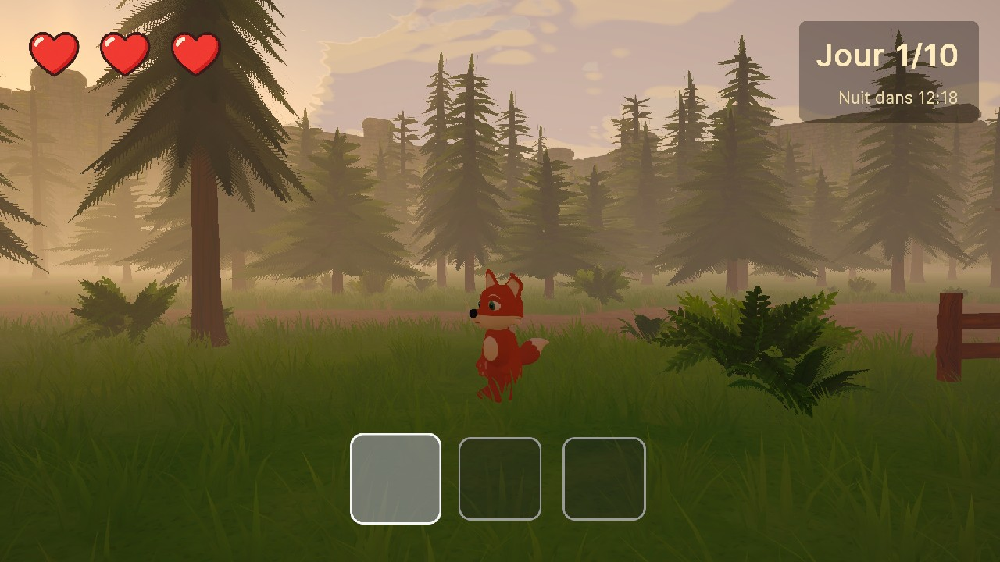
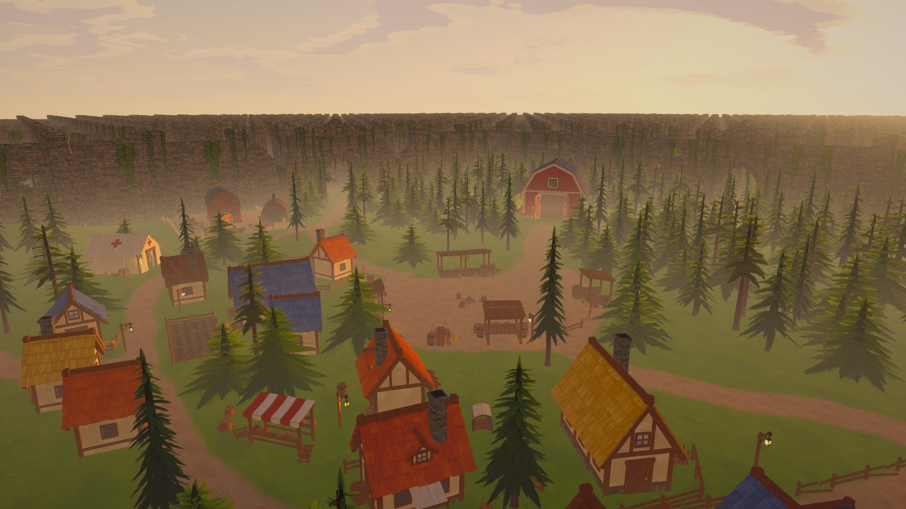
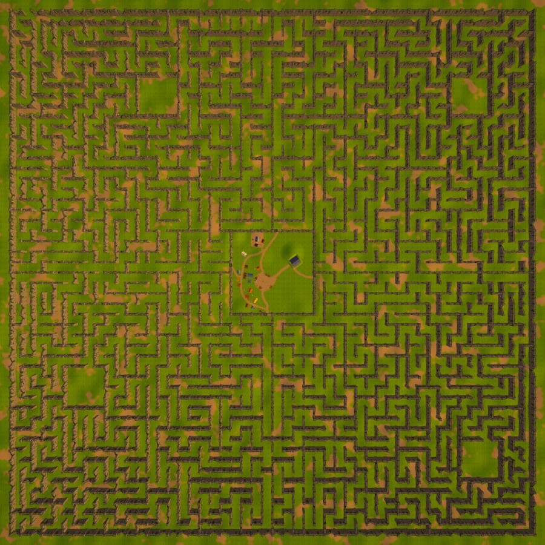
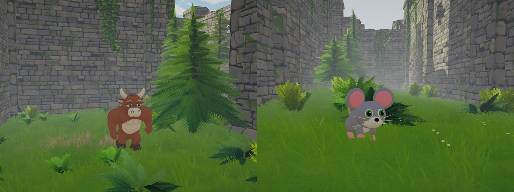

# TeamTimo

> Cute little animals, lab rats of a mad-scientist "Farmer", have **10 days** to defeat the guardians of
> four mazes, rebuild a key and escape — while every morning the Farmer kidnaps one of their villagers.

A **co-op survival / escape game** made with **Unity 6** (URP, C#) by a team of friends.
**Work in progress**: the world, the creatures and the core systems are in place; the game loop
(key fragments, guardians, kidnapped villagers) is the next step.

## The game in short

1. Players (Fox, Hen, Sheep) start in the **barn** of the Lobby, a safe village of merchant and craftsman NPCs.
2. **By day**, they explore the four zones of the maze, collect gold and items, and gear up in the village.
3. **By night**, monsters get stronger but the guardians sleep: the time to steal the **key fragments**.
4. **Every morning**, the Farmer kidnaps an NPC, whose service is lost for the rest of the run.
5. With the four fragments, the Blacksmith forges the **Master Key**: open the exit before the end of day 10.

## Technical highlights

*A maze generated at runtime, seen from above: four zones around the central Lobby village. Every run produces a new layout.*

| System | Scripts |
| --- | --- |
| **Procedural maze** generated at runtime: four zones around the Lobby, rooms, doors between zones | `MazeGenerator`, `MazeCell` |
| **NavMesh baked at runtime** on the generated maze so enemies can find their way through it | `MazeNavMeshBuilder` |
| Procedural **terrain**, generated over several frames behind a loading screen | `TerrainGenerator`, `LoadingScreen` |
| **Enemy AI**: field-of-view detection, a bull that prepares and executes charges, a mouse driven by a patrol → chase → attack → search state machine, enemy spawning | `EnemySight`, `BullAI`, `MouseAI`, `SpawnerManager` |
| **10-day clock and day/night cycle**: lighting, sky and fog profiles; at night, enemies get faster and stronger and switch to a night look | `GameClock`, `DayNightCycle`, `EnemyNightMode` |
| **Combat**: animated melee attack timed on the impact frame, weapons, enemy health and hit feedback | `PlayerMeleeAttack`, `EnemyHealth`, `EnemyHitFeedback` |
| **Inventory** with items as ScriptableObjects (pitchfork, shovel, stick, consumables) | `InventorySystem`, `InventoryUI`, `Items/*` |
| Player controller, health, damage, **ragdoll** on death, heart-based health UI | `PlayerController`, `PlayerHealth`, `RagdollController`, `HeartUIManager` |
| **Online co-op (1–4 players)** with Netcode for GameObjects, host-authoritative: the host runs the AI and shares the maze seed and the clock | `NetworkBootstrap`, `MazeSeedSync`, `EnemyNetworkSetup`, `PlayerNetworkSetup` — **in progress**, tested locally with Multiplayer Play Mode |
| **Editor tooling** that builds the Lobby village and the walls in the scene | `Editor/LobbyVillageBuilder`, `Editor/LobbyWallsBuilder` |
| **Stylized URP shaders**: foliage with wind, bark, grass, sky, atmospheric fog, camera occlusion | `Assets/Art/Shaders/` |

### Art made with code

The characters (Fox, Bull, Mouse), the village, the maze walls, the trees and the items are our own.
They are **built by Python scripts in Blender** (modeling, rigging, animation, procedural textures, FBX export),
kept in [`ArtSource/`](ArtSource/) next to the `.blend` files they produce: any asset can be rebuilt or
tweaked by editing its script.

### Working with an AI coding assistant

Since 2026, the project has been developed with **Claude Code** (the commits it co-wrote are marked
`Co-Authored-By: Claude`). [`CLAUDE.md`](CLAUDE.md) holds the project's conventions for it: C# and Unity
rules, asset safety (`.meta` files, scenes), and how it drives the Unity Editor through the Unity CLI
to compile, run Play mode and check the console. Our Game Design Document, which `CLAUDE.md` refers to,
is kept private.

## Team

| Member | Main contributions |
| --- | --- |
| **Gabin Mondongou** ([@Vollab0](https://github.com/Vollab0)) | Lead developer (103 of 137 commits): procedural maze and runtime NavMesh, terrain, enemy AI and vision (bull, mouse), day/night cycle and clock, combat, inventory and items, player systems and UI, multiplayer architecture, Blender art pipeline, shaders, git workflow |
| [@Albrosss](https://github.com/Albrosss) | Object grabbing, item data, game manager |
| [@w4lou](https://github.com/w4lou) | First version of the bull AI, enemy spawner |
| [@luls302](https://github.com/luls302), [@Mahtze](https://github.com/Mahtze), [@Eskioi](https://github.com/Eskioi) | Contributions to the project |

## About this repository

This is the **public version** of our team repository. Its history was rewritten to remove:

- our **Game Design Document** (an Obsidian vault), which stays private;
- third-party assets that may not be redistributed (Unity Asset Store packs, Mixamo characters and animations).

Everything else — code, scenes, prefabs, our own models and textures, and the commit history — is preserved.
The current version contains **no third-party asset**: every model and texture is made by the team.
In older commits, some prefabs and materials point to the removed assets and show up pink.

## Open the project

- Open the repository root with **Unity 6000.3.28f1** (Unity 6.3 LTS). Main scene: `Assets/Scenes/Labyrinthe.unity`.
- Press Play: the Editor hosts a game automatically. The maze and the terrain take about 30 seconds to generate.

## Credits

- Earlier versions of the project (in the commit history) use stylized textures from
  [3dtextures.me](https://3dtextures.me/) (CC0) and the [Lilita One](https://fonts.google.com/specimen/Lilita+One)
  font (SIL Open Font License).
